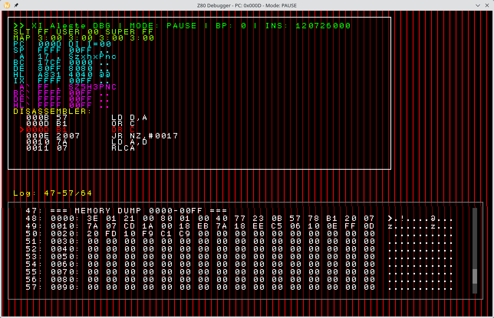

# Aleste LX — A Virtual 8-Bit Platform and BIOS Development Kit

**Aleste LX** is a design-first 8-bit computer platform. It does not yet exist as physical hardware — and that is intentional. The project is built around a simple observation:

> You cannot boot a machine without firmware, and you cannot develop firmware for a machine that does not yet exist.

Aleste LX breaks this deadlock by providing a **virtual hardware platform, BIOS, driver model, and debugger**, all integrated into a self-contained emulator. You can design the hardware, declare drivers in assembly, build a ROM image, and run it — before flashing a single FPGA.

Aleste LX is a successor to the original *Aleste EX* architecture. It retains what worked while addressing several of the original design's shortcomings: a cleaner memory map, a proper driver dispatch mechanism, well-defined error handling, and a stable ABI for applications.



---

## Why This Project Might Be Useful to You

This repository is published in an unfinished, frozen state. Its primary value lies in the **architecture and development workflow**, rather than in a complete feature set.

It demonstrates a practical approach to developing software for hardware that does not yet exist — or for hardware that lacks a usable emulator.

You may find it useful if you want to:

- Write Z80 software for a computer that has no existing emulator.
- Prototype a retro-style FPGA-based system and develop its firmware before the hardware is ready.
- Design a BIOS and driver model with a stable call table and test it entirely in software.
- Study an example of **hardware abstraction implemented through virtualization**: the emulator does more than execute Z80 instructions; it also implements the video modes, sound interfaces, and memory mapping planned for the eventual hardware.

In short, Aleste LX is a **forkable foundation for bootstrapping your own platform**.

---

## The Core Idea

The project is built around three layers developed in parallel.

### 1. Virtual Hardware

The emulator lives in `emulator/`. It contains a Z80 CPU core, provided by the bundled `z80ex` dependency, along with virtual implementations of the Aleste LX peripherals:

- CRTC
- Palette
- Video buffer
- MMU
- AY-8910 audio
- Debugger overlay

### 2. BIOS and Drivers

The BIOS and drivers are written in Z80 assembly and live under `bios/`, `drivers/`, and `fonts/`.

Drivers are registered in a **driver table** with a defined method layout. Applications can invoke driver functionality through a stable interface rather than relying on hard-coded hardware addresses.

### 3. Applications

Applications can be written in C or assembly. See `main.c` for an example.

They access the BIOS interface through the headers and definitions provided in `include/` and `inc/`.

### The Include Directory Split

The project separates public interfaces from internal implementation details:

- `include/` — public C headers for application developers.
- `inc/` — corresponding assembly includes, constants, and equates.
- `drivers/` — internal driver implementations, built into the BIOS image.

This separation keeps the application-facing ABI independent of driver implementation details.

---

## Repository Layout

```text
aleste-xi-bios/
├── asm/                 CRT0 and linker sections for the BIOS image
├── bios/                BIOS entry points and error handling
├── drivers/             Driver implementations (assembly)
│   ├── audio/           AY-8910 driver
│   ├── crtc/            CRTC driver and video modes
│   ├── dma/             DMA blitter (all drawing goes through it)
│   ├── fdc/             uPD765 floppy controller
│   ├── int/             Interrupt dispatcher for the native PIC (IM 1)
│   ├── kbd/             PS/2 keyboard
│   ├── mmu/             Memory management unit driver
│   ├── palette/         12-bit palette driver
│   ├── snd/             Magic Sound 2
│   ├── timer/           System timer
│   ├── vbuf/            Video buffer driver (640x200x2, 320x200x256)
│   └── video/           Video composition
├── fonts/               Bitmap fonts (Windows-1252)
├── inc/                 Assembly includes (bios/, drivers/, hardware/)
├── include/             C headers (bios/, drivers/, hardware/)
├── src/                 Console, FAT12, MOD player, boot tune
├── src/drivers/         C-side driver wrappers
├── dos/                 LX-DOS (loaded from floppy as LXDOS.SYS) and its test programs
├── tools/               Floppy images (MSX-DOS, EDSK), LXI images, the test MOD (Python)
├── services/            Higher-level services (console, filesystem, players) — planned
├── emulator/            Virtual platform and debugger
│   ├── src/             CPU, MMU, CRTC, palette, ports, screen, debugger
│   └── test/            Minimal test ROM and build script
├── deps/z80ex/          Bundled Z80 CPU emulation library
├── output/              LX.ROM (64 KB), bios_abi.asm, LXDOS.SYS (built)
└── main.c               The ROM monitor
```

## Documentation

The Aleste LX documentation repository contains architectural documentation, BIOS design notes, and supporting technical specifications.

**Start here:**

- **[Aleste LX Documentation](https://github.com/hww/aleste-xi-doc)** — the main documentation repository.
- [Aleste LX Platform Documentation](https://github.com/hww/aleste-xi-doc/blob/main/aleste-lx/aleste-xi.pdf) — platform architecture and design.
- [BIOS Architecture](https://github.com/hww/aleste-xi-doc/blob/main/bios/aleste-bios.pdf) — BIOS architecture and the driver interface.

The documentation complements the source code by explaining the architectural concepts behind the platform, including the BIOS, driver model, and hardware abstractions.

---

## Installation (Ubuntu)

The toolchain requires a **native Z88DK build with the SDCC compiler engine enabled (`BUILD_SDCC=1`)**, rather than a prebuilt package that lacks the required compiler.

The following steps describe the intended setup.

### 1. Install Prerequisites

```bash
sudo apt update
sudo apt install -y bison flex subversion
sudo apt install -y libsdl2-dev libreadline-dev libgmp-dev libboost-graph-dev
```

### 2. Build Z88DK from Source

Download and build Z88DK with the SDCC compiler engine enabled:

```bash
cd ~
wget https://github.com/z88dk/z88dk/releases/download/v2.4/z88dk-src-2.4.tgz
tar -xvzf z88dk-src-2.4.tgz
cd z88dk
make BUILD_SDCC=1
sudo make install
```

The `BUILD_SDCC=1` option is required because the Aleste BIOS build depends on the SDCC-based `zsdcc` compiler. A default Z88DK build may not provide this compiler.

### 3. Configure the Environment

Set the environment variables for the current shell session:

```bash
export Z88DK_PATH="$HOME/z88dk"
export PATH="$Z88DK_PATH/bin:$PATH"
export ZCCCFG="$Z88DK_PATH/lib/config/"
```

To persist these settings across terminal sessions, add them to `~/.bashrc`:

```bash
echo 'export Z88DK_PATH="$HOME/z88dk"' >> ~/.bashrc
echo 'export PATH="$Z88DK_PATH/bin:$PATH"' >> ~/.bashrc
echo 'export ZCCCFG="$Z88DK_PATH/lib/config/"' >> ~/.bashrc
```

Reload the configuration or open a new terminal session to apply the changes.

---

## Building

### 1. Build the Emulator Dependency and Binary

First, build the bundled Z80 CPU emulation dependency (`z80ex`), then compile the emulator.

Replace the example project paths below with the actual location of your checkout.

```bash
# Build the local Z80 CPU emulation dependency
cd ~/projects/hww/_z80/aleste-xi-bios/deps/z80ex
make

# Build the emulator
cd ~/projects/hww/_z80/aleste-xi-bios/emulator
make clean && make
```

### 2. Build the BIOS (LX.ROM) and LX-DOS (LXDOS.SYS)

From the project root. `Z88DK_PATH` defaults to the path in the `Makefile`;
set it on the command line if yours is different (or leave `zcc` in the PATH).

```bash
cd ~/projects/hww/_z80/aleste-xi-bios
make clean
make Z88DK_PATH=$HOME/z88dk     # or: make rom / make dos
```

The results are written to `output/`:

- `LX.ROM` — the 64 KB BIOS image (the MiSTer core's `boot.rom`, optionally
  followed by the 520EX ROM, AL512.BIN);
- `bios_abi.asm` — the addresses of the resident drivers, for programs linked
  against the ROM; its fingerprint is stored in the ROM and checked by LX-DOS;
- `LXDOS.SYS` — LX-DOS;
- `LXDOS.DSK` (`make disk`, needs python3) — the LX-DOS boot floppy: LXDOS.SYS,
  the test programs, the images and the test MOD (`dos/disk/README.TXT`
  lists them).

---

## Running

The emulator for the full LX machine is `alestelx` (`emulator/lx`); see
[`emulator/lx/README.md`](emulator/lx/README.md) for building it (CMake + SDL2)
and its options:

```bash
cd ~/projects/hww/_z80/aleste-xi-bios/emulator
cmake -S . -B build && cmake --build build
./build/alestelx -a LXDOS.DSK ../output/LX.ROM
```

---

## The LX BIOS, LX-DOS and the MiSTer Core

The BIOS in this repository is the one the **Aleste LX MiSTer core** boots:

- **Core:** [shaeon/AlesteLX_MiSTer](https://github.com/shaeon/AlesteLX_MiSTer)
  (Shaeon, Carlos Palmero) — the FPGA implementation of this design, with the
  PIC and system timer, Magic Sound 2 (4 DMA sample channels at 48 kHz), the
  DMA blitter, the PS/2 keyboard and the uPD765 floppy controller.

The core takes `output/LX.ROM` from this repository. What each part does:

| Part | Where | What it does |
|---|---|---|
| Linker map and startup | `asm/sections.asm`, `asm/crt0_aleste.asm` | Places every section at its fixed address (see *Building*); IM 1 at 0038h jumps to the interrupt driver; the stack is at the top of window 2 (BFF0h) |
| Interrupts | `drivers/int` | Dispatches the native PIC lines (0 floppy, 1 DMA, 2 VBlank, 3 Magic Sound 2, 4 Gate Array 300 Hz, 6 timer) to one handler each |
| Timer | `drivers/timer` | Milliseconds and uptime |
| DMA | `drivers/dma` | Copies and fills rectangles in physical memory; all drawing goes through it, so no window is needed for VRAM |
| Video | `drivers/crtc`, `drivers/vbuf`, `drivers/palette` | Video modes (640x200x2 text, 320x200x256), glyph drawing, the 12-bit palette |
| Keyboard, sound, floppy | `drivers/kbd`, `drivers/snd`, `drivers/fdc` | PS/2 keyboard; Magic Sound 2; uPD765 sectors (720 KB) |
| Console, files, music | `src/console.c`, `src/fat.c`, `src/mod.c`, `src/tune.c` | Text console with a status line; FAT12 read/write; MOD player; the boot tune |
| ROM monitor | `main.c` | HELP, CLS, TIME, BEEP, KEYB, PLAY, DIR, LOAD, MOD, STOP, DUMP, KEYS, DEMO, BOOT (LX-DOS), 520EX (the compatible mode) |
| Booting a system | `bios/boot.asm` | Maps LXDOS.SYS (banks 20h-22h of slot 3) into windows 0-2 and jumps to it; window 3 keeps the drivers |
| ABI | `output/bios_abi.asm` | The fixed addresses of the resident drivers; programs such as LX-DOS are linked against it, and its fingerprint is checked at boot |
| LX-DOS | `dos/` | CP/M 2.2 and MSX-DOS 1 compatible DOS, with LX extensions for music and graphics; `bios/dosgate.asm` holds the gates between .COM programs and LX-DOS |
| Tests | `dos/test/` | Programs with their prebuilt .COM files: files, MSX-DOS calls, graphics, the syscall protocol (`sys/SYSTEST`: `OUT (F2h),A`, exit on RET, interrupt hold) and ZEXALL/ZEXDOC |

The supervisor/user mode and the syscall protocol (`OUT (F2h),A`, the exit on
RET and the interrupt hold on control bit 3) are described in
[`doc/aleste-lx.md`](https://github.com/shaeon/AlesteLX_MiSTer/blob/main/doc/aleste-lx.md)
of the core and in the documentation repository.

---

## The Driver Model

Drivers are exposed through a **call table**, rather than through a collection of fixed entry-point addresses.

Each driver has a struct-like method layout defined in `inc/drivers/*.inc` and `include/drivers/*.h`. The BIOS dispatches calls through this interface, allowing applications to use driver functionality without accessing hardware ports directly.

Driver methods return error codes defined in `inc/bios/errors.inc`, such as `ERR_SUCCESS`. Unknown methods are routed to `bios/undefined_method.asm`, allowing unsupported calls to fail predictably instead of producing undefined behavior.

This approach provides three important benefits for an 8-bit development platform:

- **Stable ABI** — applications compile against public headers rather than hard-coded addresses.
- **Testability** — drivers can be replaced with alternative implementations or stubs in the emulator.
- **Portability** — application code can potentially run on both the emulator and the eventual FPGA hardware, provided that the driver table and underlying interfaces remain compatible.

---

## The Emulator as a Design Tool

The emulator in `emulator/` is not intended to be a generic Z80 machine. It is a **virtual implementation of Aleste LX**.

It provides:

- The video modes exposed by the CRTC driver.
- The 12-bit palette.
- The video buffer layout planned for the future FPGA implementation.
- An **in-emulator debugger** whose interface is rendered over the emulated screen, allowing you to debug the machine from within its own environment.

The emulator therefore serves as a reference implementation for the planned hardware.

One of the project's goals is to make it possible to boot the same BIOS image on the eventual FPGA implementation without modification. Achieving that will depend on the hardware matching the interfaces and behavior defined by the emulator.

---

## Project Status

**Aleste LX is unfinished and no longer actively developed.**

The following components are available:

- The emulator builds and runs a Z80 image.
- The bundled Z80 CPU emulation dependency builds.
- The BIOS and driver source trees, along with their C and assembly interfaces, are in place.
- The BIOS and LX-DOS build into `output/LX.ROM` and `output/LXDOS.SYS` (see *The LX BIOS, LX-DOS and the MiSTer Core*).

The following areas remain incomplete:

- Some drivers, including `video` and `storage`, are stubs; parts of `services/` are planned or unfinished.
- The debugger is functional but does not implement all intended features.

The main reason to explore or fork this repository is its **architecture and development workflow**, not its completeness as a finished product.

---

## Forking Aleste LX for Your Own Platform

If you want to use Aleste LX as a starting point for your own machine, the recommended approach is:

1. **Define the memory map and hardware ports** in `inc/hardware/` and `include/hardware/`.
2. **Specify the driver interfaces** in `inc/drivers/` and `include/drivers/`, including method layouts and error codes.
3. **Implement the drivers** in `drivers/` using assembly and the conventions established in `inc/bios/drivers.inc`.
4. **Implement the virtual hardware** in `emulator/src/`, including ports, MMU, video, and audio, so the emulator behaves like the intended hardware.
5. **Write applications** against the public interfaces in `include/`. Once the emulator supports the required functionality and the hardware implements compatible interfaces, the same application code can be used on the physical platform.

You do not need an FPGA to get started. You need a contract — the driver interface — and a reference implementation — the emulator.

That is the foundation Aleste LX provides.

---

## License

See [`LICENSE`](LICENSE) for licensing information.
